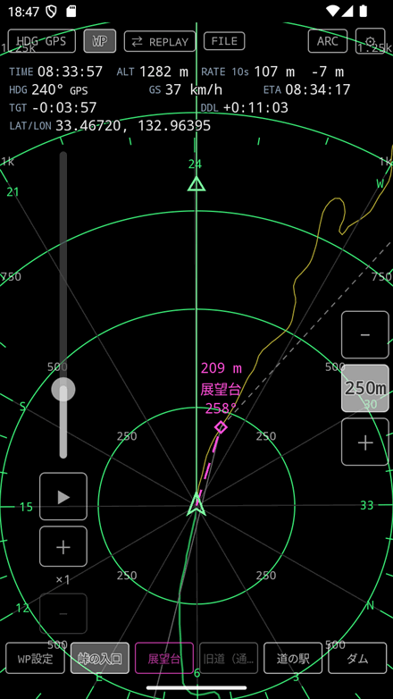
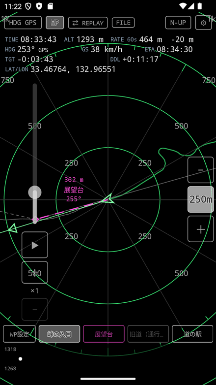
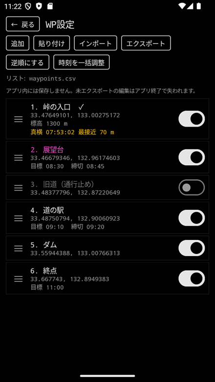
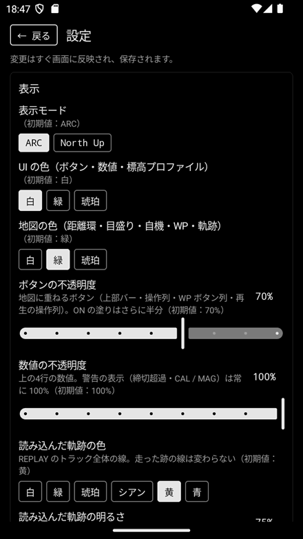

# NavHUD（目標針路案内アプリ）

航空機の ND（ナビゲーション表示）風の画面で、WP（目標地点）までの方位・距離・時刻を案内する Android アプリです。黒い画面に、自機・距離環・WP の位置関係を線で描きます。地図の API は使わず、アプリに入れた地図のデータ（海岸線・道路・鉄道・空港・山頂など）を背景に暗く描きます。

  
  
  
  

※スクリーンショットは、記録したサンプルデータを再生（REPLAY）した画面です。左から 普段の画面（ARC）/ North Up / WP の一覧 / 設定。

## 特徴

- **ARC / North Up の表示** — 進行方向を上にする表示と、北を上にする表示を切り替え
- **次の WP への案内** — 距離・名前・方位を画面に表示。画面の外にある WP は、その方向の端に表示
- **WP の到達の自動判定** — 到達半径・横を通過・通過（予備）の3つで判定し、自動で次の WP へ進む
- **AUTO の縮尺** — 次の WP が画面に入る縮尺を自動で選び、近づくと詳細に切り替え
- **目標時刻・締切時刻との差** — WP ごとの目標時刻（TGT）・締切時刻（DDL）までの時間と、到着予想（ETA）を表示
- **背景地図** — 海岸線・境・道路・鉄道・河川・航路の線と、空港・滑走路・山頂の記号を、HUD の邪魔にならない暗さで描く（項目ごとに、どの縮尺まで描くかを選べます）
- **記録の再生（REPLAY）** — GPS の記録（track.csv）を、速度を変えて再生
- **通信をしない** — 地図も含めてアプリの中のデータだけで動くので、携帯の電波が届かない所でも使えます
- **日本語・英語対応** — 設定画面で切り替えられます

## 動作環境

- Android 8.0（API 26）以降
- GPS が使える端末（コンパスのある端末では、方位にコンパスも使えます）

## 画面構成

- **上部のボタン** — 方位の取り方（HDG）、WP ボタン列の表示、LIVE / REPLAY の切り替え、ARC / North Up、設定
- **数値の行** — 時刻、標高、移動距離と高度差、方位、速度、ETA、TGT / DDL、緯度・経度
- **地図の部分** — 自機、距離環、WP の印と線、次の WP の文字、走った跡、背景地図
  - ドラッグで先を見る（パン。地図の中心に小さな十字が出ます）
  - ピンチで縮尺を詳細・広域に（R1 100 km まで）
  - ダブルタップでその所を基準に 1 段詳細に
  - 2 本指で軽くタップすると 1 段広域に（− と同じ）
- **右の縮尺のボタン** — ＋ / − と、AUTO の切り替え
- **下の WP ボタン列** — タップで到達済みの切り替え、長押しでその WP へパン。その下に標高プロファイル（設定で表示）

初めて起動したとき（位置がまだ分からないとき）は、皇居のあたりを R1 10 km で表示します。2 回目からは、前回最後にいた所を表示します。位置が来るまでのあいだも、地図を動かしたり縮尺を変えたりできます。

詳しい使い方は [チートシート（PDF）](docs/cheatsheet.pdf) にまとめています（A4 1枚）。

## ファイル形式

- **WP リスト（CSV）** — 読み込みと書き出し。1行目は見出しで、必須は `lat` と `lon` です。名前・標高・目標時刻・締切時刻なども書けます。Excel で編集できます。
- **WP リスト（GPX）** — 読み込みのみ。`<wpt>` の位置と名前などを読みます。
- **再生用の記録（track.csv）** — 読み込みのみ。見出しに `latitude`・`longitude` と、時刻（`epoch_ms` か `utc_iso8601`）が必要です。[GpsLogger](https://github.com/eightbrows/GpsLogger) が記録する track.csv の形式です。
- **GpsLogger の zip** — GpsLogger で書き出した zip をそのまま読めます。中のセッションの一覧から1つ選んで再生します。

列の意味や書き方は [ファイル形式の説明（PDF）](docs/formats.pdf) にまとめています。

ご注意：WP リストはアプリの中に保存しません。編集したら CSV に書き出してください。

## 設定

設定画面のいちばん上に目次があり、押すとその欄へ移ります。選ぶボタンは、塗ってあるのが初期値、水色の枠が今選んでいる値です。変更はすぐ保存され、次に開いたときは前に見ていた位置から表示します。

- **表示** — ARC / North Up、UI と地図の色（白 / 緑 / 琥珀）、ボタンと数値の不透明度、読み込んだ軌跡の色と明るさ、距離環の数字の大きさ、ARC の自機の位置、標高プロファイル、標高オフセット
- **方位** — 方位の取り方（GPS / HYBRID / COMPASS）、低速で方位を保持する速度、GPS の精度の上限
- **縮尺** — 使う縮尺の段、起動時の縮尺、AUTO の詳細の限度と広域の限度、AUTO の待ち時間など
- **WP** — 移動手段ごとの到達の判定の値（自動車 / カスタム1〜3）、WP ボタンの数など
- **測位・入力** — LIVE / REPLAY、NO FIX とみなす時間、RATE の窓
- **地図レイヤ** — 背景地図の ON / OFF、線の太さと明るさ、線の項目ごとにどの縮尺まで描くか（海岸線・県境・市区町村境・高速道路・その他の自動車専用道路・国道・県道・新幹線・在来線・河川と湖沼・フェリーの航路）
- **ランドマーク** — 明るさ、項目ごとにどの縮尺まで描くか（空港の民間・軍用 × 大・小、空港の敷地、空港の略号、滑走路、滑走路の延長線、山頂の高・中・低）
- **その他** — 画面常時点灯、前回の WP リストを自動で開く、設定を初期値に戻す
- **言語・権限・情報・データの出典** — アプリの言語（端末に合わせる / 日本語 / English）、権限の今の状態、バージョンやライセンスなど、背景地図とランドマークのデータの出典

主な初期値: 表示は North Up、使う縮尺は全部の段（R1 25 m〜100 km）、背景地図は海岸線・県境・高速道路・新幹線・河川と湖沼・フェリーの航路が「〜100k」、国道が「〜25k」、市区町村境が「〜5k」、ランドマークは空港の敷地が「〜5k」でほかは「〜100k」です。

## 権限

| 権限 | 用途 |
|---|---|
| 位置情報（正確な位置・おおよその位置） | GPS で現在地を測る。許可しなくても、記録の再生（REPLAY）は使えます |
| フォアグラウンドサービス（位置情報） | 画面を表示している間、位置の取得を続ける。バックグラウンドの位置情報は使いません |
| 通知（Android 13 以降） | 動作中であることを通知に出す。許可しなくても動きます |

インターネットの権限は持っていないので、位置や WP などのデータをアプリが端末の外に送ることはありません。ファイルの読み書きは、Android のファイル選択の画面で選んだファイルだけです。

なお、端末のバックアップ（Android の機能）を ON にしている場合、アプリの設定はそのバックアップに含まれます。

## インストール

[Releases](../../releases) から APK をダウンロードしてインストールしてください。

## 背景地図のデータ

地図のいちばん下に、次の線と記号を暗く描きます（項目ごとに、どの縮尺まで描くかを設定で選べます）。データは 1/100万相当の地図をもとにしているので、細かい道や小さな島は入っていません。

- **線** — 海岸線、県境、市区町村境、道路（高速道路は青・国道は赤・県道は茶。その他の自動車専用道路も分けて選べます）、鉄道（新幹線は実線・在来線は破線）、河川・湖沼、フェリーの航路
- **空港** — 黄緑の飛行機の記号。国土数値情報の空港（自衛隊との共用を含む）は塗りつぶし、自衛隊・米軍の飛行場は白抜き。いちばん長い滑走路が 2,000 m 以上は大きな記号（民間は丸い輪付き）、600 m 以上は小さな記号です（600 m 未満は描きません）。記号の右上に ICAO の略号を出し、略号どうしが重なるときは大きい空港を優先します。空港の敷地は薄く塗ります。
- **滑走路** — 両端を結ぶ線（太さは実際の幅）と、両端の先の破線の延長線。両端の位置が分からない滑走路は、滑走路が 1 本だけの空港なら、空港の位置・長さ・向きから推定して描きます。
- **山頂** — 桃色の三角。目印になる山（標高 800 m 以上で、10 km 以内に自分より高い山がないもの）を高（1,500 m 以上）・中、ほかを低として、3 段の大きさで描きます。

地図に出している飛行場と、出していない飛行場とその理由は、[飛行場の一覧](docs/airports.html) にまとめています。飛行場ごとの番号（A001 など）は、データが変わっても変えず、使い回しません。

背景地図：「地球地図日本」（国土地理院）（https://www.gsi.go.jp/kankyochiri/gm_jpn.html）をもとに作成

山頂：「日本の主な山岳標高一覧（1003山）」（国土地理院）をもとに作成

空港：「国土数値情報（空港データ）」（国土交通省）（https://nlftp.mlit.go.jp/ksj/gml/datalist/KsjTmplt-C28-2021.html）をもとに作成

空港の略号、自衛隊・米軍の飛行場、滑走路：OurAirports（https://ourairports.com/data/）（パブリックドメイン）

## ライセンス

Apache License 2.0 の下で公開しています。詳細は [LICENSE](LICENSE) を参照してください。
