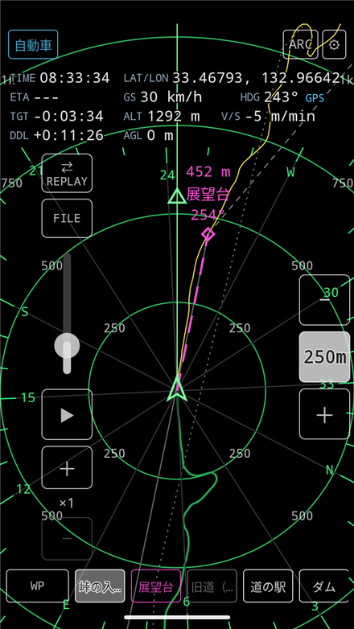
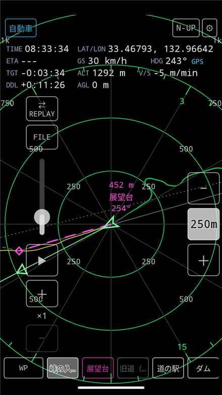
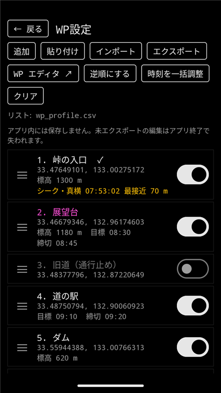
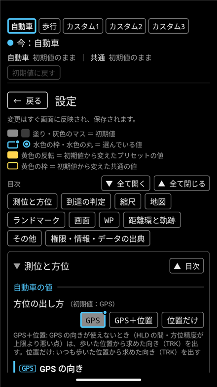

# NavHUD（目標針路案内アプリ）

航空機の ND（ナビゲーション表示）風の画面で、WP（目標地点）までの方位・距離・時刻を案内する Android アプリです。黒い画面に、自機・距離環・WP の位置関係を線で描きます。地図の API は使わず、アプリに入れた地図のデータ（海岸線・道路・鉄道・空港・山頂など）を背景に暗く描きます。

  
  
  
  

※スクリーンショットは、記録したサンプルデータを再生（REPLAY）した画面です。左から 普段の画面（ARC）/ North Up / WP の一覧 / 設定。

## 特徴

- **ARC / North Up の表示** — 進行方向を上にする表示と、北を上にする表示を切り替え
- **次の WP への案内** — 距離・名前・方位を画面に表示。画面の外にある WP は、その方向の端に表示
- **WP の到達の自動判定** — 到着半径・真横通過・通過（予備）の3つで判定し、自動で次の WP へ進む
- **移動のプリセット** — 自動車・歩行・カスタム1〜3 を切り替えると、方位の出し方・到達の判定・縮尺・地図の項目などがまとめて替わる。どのプリセットも値を変えられ、変えた所は黄色で分かる
- **歩くときの方位** — 歩くと GPS の向きがふらつくので、歩行のプリセットでは歩いた位置から向きを求める（TRK）。位置の精度が悪いときは自動で長い距離から求め、止まっている間は向きを変えない。直近の向きの平均を、短いシアンの線（平均した方位線）でも描く
- **AUTO の縮尺** — 次の WP が画面に入る縮尺を自動で選び、近づくと詳細に切り替え
- **目標時刻・締切時刻との差** — WP ごとの目標時刻（TGT）・締切時刻（DDL）までの時間と、到着予想（ETA）を表示
- **背景地図** — 海岸線・境・道路・鉄道・河川・航路の線と、空港・滑走路・山頂の記号を、HUD の邪魔にならない暗さで描く（項目ごとに、どの縮尺まで描くかを選べます）
- **昇降率（V/S）と地上高（AGL）** — 今の上り下りの速さ（m/min）と、その場所の地面の高さ（約 250 m 四方でいちばん高い所）との差を表示。地上高に建物や木は入らないので、地上を走るときは 0 か負になります（負の値は「0 にする」か「負のまま赤で出す」を選べます）
- **記録の再生（REPLAY）** — GPS の記録（track.csv・GpsLogger の zip）を、速度を変えて再生。歩行では、記録の細かなジグザグをならした線で描く
- **通信をしない** — 地図も含めてアプリの中のデータだけで動くので、携帯の電波が届かない所でも使えます
- **日本語・英語対応** — 設定画面で切り替えられます

## 動作環境

- Android 8.0（API 26）以降
- GPS が使える端末

## 画面構成

- **上部バー** — 左に今の移動のプリセット（自動車は水色・歩行は緑・カスタムは紫の枠。押しても変わりません）、まん中に位置がないときの NO FIX、右に ARC / N-UP の切り替えと設定（⚙）
- **数値の行** — 左の列に時刻（TIME）・到着予想（ETA）・目標時刻まで（TGT）・締切時刻まで（DDL）、右に緯度・経度、速度（GS）と方位（HDG）、標高（ALT）と昇降率（V/S）、地上高（AGL）
  - HDG の横の小さな文字は、使っている方位です。GPS（水色）は GPS の向き、HLD（水色）は遅いので止めて保っている向き、TRK（橙）は歩いた位置から求めた向きです。TRK は、位置の精度が悪いときは自動で長い距離（最長 15 m）から求め、止まっている間（5 秒で 4.2 m 動くまで）は向きを変えません
  - V/S は今の昇降率（坂が変わると約 8 秒で追いつく。5 m/min 単位）です
  - 標高は、Android 14 以降では端末の仕組みで求めた海抜高度です（それより前の Android では GPS の高さ − 標高オフセット）
- **地図の部分** — 自機、距離環、WP の印と線、次の WP の文字、走った跡、背景地図
  - 歩行では、自機から短いシアンの線（平均した方位線）が出ます。直近 5 秒の向きを、動いた距離で重みを付けて平均した向きです（止まっている間は止まる前の向き）。地図の向きと HDG は今の向きのままです
  - ドラッグで先を見る（パン。地図の中心に小さな十字が出ます）
  - ピンチで縮尺を詳細・広域に（R1 100 km まで）
  - ダブルタップでその所を基準に 1 段詳細に
  - 2 本指で軽くタップすると 1 段広域に（− と同じ）
- **左の列** — LIVE / REPLAY の切り替え（⇄）。REPLAY のときは、その下にファイル（FILE）、再生位置のスライダー、再生 / 一時停止、倍速
- **右の縮尺のボタン** — ＋ / − と、AUTO の切り替え
- **下の WP ボタン列** — 左端の「WP」で WP設定の画面。WP のボタンはタップで到達済みの切り替え、長押しでその WP へパン。その下に標高プロファイル（設定で表示）
- 位置がないとき・ファイルを読み込んだときのお知らせは、WP ボタン列のすぐ上に出ます

初めて起動したとき（位置がまだ分からないとき）は、皇居のあたりを R1 10 km で表示します。2 回目からは、前回最後にいた所を表示します。位置が来るまでのあいだも、地図を動かしたり縮尺を変えたりできます。WP リストを読み込んでいれば、位置が来る前から WP の印と線も表示します。記録の再生（REPLAY）では、記録を読み込んだ時点で、最初の点を自機の位置として止めた状態で表示します。

詳しい使い方は [チートシート（PDF）](docs/cheatsheet.pdf) にまとめています（A4 1枚）。

## ファイル形式

- **WP リスト（CSV）** — 読み込みと書き出し。1行目は見出しで、必須は `lat` と `lon` です。名前・標高・目標時刻・締切時刻なども書けます。Excel で編集できます。
- **WP リスト（GPX）** — 読み込みのみ。`<wpt>` の位置と名前などを読みます。
- **再生用の記録（track.csv）** — 読み込みのみ。見出しに `latitude`・`longitude` と、時刻（`epoch_ms` か `utc_iso8601`）が必要です。[GpsLogger](https://github.com/eightbrows/GpsLogger) が記録する track.csv の形式です。
- **GpsLogger の zip** — GpsLogger で書き出した zip をそのまま読めます。中のセッションの一覧から1つ選んで再生します。セッションに歩数（steps.csv）があれば読み、読み込んだときのひとことに合計の歩数（counter を、一時停止で区切った区間ごとに足した数）を出します。歩数は今は、方位や到達の判定には使っていません。

列の意味や書き方は [ファイル形式の説明（PDF）](docs/formats.pdf) にまとめています。

ファイルは、ファイルの画面（記録は左の列の FILE、WP リストは WP設定の「インポート」）から開きます。最近開いたファイル（5 件まで）からも開けます。WP リストと記録はファイルの中身で見分けていて、違う種類のファイルを選んだときは読み込まずに知らせます。読み込むと、地図の画面に数秒だけ件数や時刻のひとことが出ます。

ご注意：WP リストはアプリの中に保存しません。編集したら CSV に書き出してください。

WP リストは、ブラウザで使う [WP エディタ](https://eightbrows.github.io/navhud-wp-editor/) でも作れます（WP設定の画面の「WP エディタ」と、設定の「情報」から開けます）。

読み込んでいる WP リストと再生用の記録は、それぞれ「クリア」で外せます（WP リストは WP設定の画面、記録はファイルの画面）。外すと、次に起動したときも前のファイルを開きません。

## 移動のプリセット

設定画面のいちばん上の帯で、自動車・歩行・カスタム1〜3 を選びます。選んでいるプリセットの名前は、メイン画面の上部バーの左にも出ます。

| 値 | 自動車 | 歩行 |
|---|---|---|
| 方位の出し方 | GPS | 位置だけ（TRK） |
| 方位を止める / 戻す速度 | 4 / 6 km/h | 1 / 3 km/h |
| 方位精度の上限 | 20° | 30° |
| 向きを求める距離 | 8 m | 4 m |
| 到着半径 | 30 m | 15 m |
| 真横通過（WP までの距離・判定を始める速さ） | 150 m・11 km/h | 50 m・2 km/h |
| 通過判定（最接近距離の上限・続く時間） | 300 m・5 秒 | 50 m・3 秒 |
| GS の平均 / ETA の平均速度 | 1 秒 / 10 秒 | 5 秒 / 60 秒 |
| 平均した方位線（平均する秒数） | OFF（5 秒） | ON（5 秒） |
| 軌跡の点の間隔 | 10 m | 3 m |
| 軌跡のなめらかさ | なし | 3 m |

- **方位の出し方** — GPS（GPS の向き。遅いときは止めて保つ）、GPS＋位置（GPS の向きが使えないときだけ、歩いた位置から求めた向き）、位置だけ（いつも歩いた位置から求めた向き）の 3 つです。歩行では「位置だけ」で、直前に 4 m 歩いた所と今の位置を結ぶので、角を曲がると 1〜2 秒で新しい道の向きになります。位置の精度が悪いときは、結ぶ距離が自動で長くなります（水平精度と同じ長さ。最長 15 m）。止まっている間は、5 秒前の位置から 4.2 m 動くまで向きを変えません（その場の位置の揺れで向きが回らないように）。この 2 つはどのプリセットにも同じ決まりで、設定にはありません。
- **どのプリセットも変えられます。** アプリが覚えるのは初期値から変えた所だけで、変えていない値は、アプリを新しくして初期値が変わると新しい値になります。
- カスタムは、自動車か歩行の値をもとにします（「初期値に戻す…」で自動車・歩行の初期値、「コピーする…」で今の自動車・歩行の値を入れられます）。
- 縮尺・地図の項目・ランドマーク・標高プロファイルもプリセットごとの値です（歩行の初期値は自動車と同じ）。
- **平均した方位線** — 直近の向きの平均を、自機から短いシアンの線で描きます（今の方位線の半分の長さ）。まっすぐ歩くときの目安です。平均する秒数は 3〜10 秒。
- **軌跡の点の間隔・軌跡のなめらかさ** — 読み込んだ軌跡をこの間隔に間引いて描きます（走った跡はその半分）。なめらかさは、前後の点の位置を平均して GPS の細かなジグザグを減らす強さです（描く線だけで、記録や計算には使いません。走った跡は、その 3 倍の距離だけ後ろから決まります）。色や不透明度など、ほかの値はどのプリセットでも同じ「共通の値」です。

## 設定

設定画面のいちばん上に、移動のプリセットの帯（プリセットのボタン、今のプリセット、変えた所の数、初期値に戻す / コピーする）があります。その下に目次があり、押すとその欄へ移ります。

- 欄の中は「自動車の値」（今のプリセットの値）と「共通の値」に分かれています。
- 選ぶボタンは、塗ってあるのが初期値、水色の枠が今選んでいる値です。どの項目にも「（初期値：…）」を書いています。
- 初期値から変えた値は、プリセットの値なら **黄色の反転**、共通の値なら **黄色の枠** で強調します。帯には「自動車 変えた所 3 ｜ 共通 変えた所 2」のように数が出ます。
- 変更はすぐ保存され、次に開いたときは前に見ていた位置から表示します。

欄:

- **測位と方位** — 方位の出し方、GPS の向き（方位を止める / 戻す速度・方位精度の上限）、位置から求める向き（向きを求める距離）、平均した方位線と平均する秒数、地上高の負の値、位置精度の上限、測位が途切れたとみなす時間、標高オフセット（Android 14 以降では使いません）
- **到達の判定** — 到着半径、真横通過（WP までの距離・離れたとみなす距離・判定を始める速さ）、通過判定（予備）
- **縮尺** — 使用する縮尺、起動時の縮尺、起動時に自動縮尺にする、自動縮尺の詳細の下限・広域の上限、待機時間など、地図をスクロールした後に現在地へ戻るまでの時間
- **地図** — 線の項目ごとにどの縮尺まで描くか（海岸線・県境・市区町村境・高速道路・その他の自動車専用道路・国道・県道・新幹線・在来線・河川と湖沼・フェリーの航路）、背景地図の ON / OFF、線の太さと明るさ
- **ランドマーク** — 項目ごとにどの縮尺まで描くか（空港の民間・軍用 × 大・小、空港の敷地、空港の略号、滑走路、滑走路の延長線、山頂の高・中・低）、明るさ
- **画面** — 標高プロファイル、GS の平均、ETA の平均速度、UI と地図の色（白 / 緑 / 琥珀）、ボタンと数値の不透明度、ARC の自機の位置
- **WP** — 前回の WP リストを自動で開く、WP ボタン列に見せる数、HUD に描く WP の数
- **距離環と軌跡** — 軌跡の点の間隔と軌跡のなめらかさ（プリセットの値）、距離環の明るさと数字の大きさ、読み込んだ軌跡の色と明るさ
- **その他** — 画面常時点灯、アプリの言語（端末に合わせる / 日本語 / English）
- **権限・情報・データの出典** — 権限の今の状態、バージョンやライセンスなど、背景地図・ランドマーク・地上高のデータの出典

いちばん下の「設定を初期値に戻す」は、全部のプリセット（カスタムも）と共通の値を初期値にします（表示言語はそのまま）。

主な初期値: 表示は ARC、使う縮尺は全部の段（R1 25 m〜100 km）、背景地図は海岸線・県境・高速道路・新幹線・河川と湖沼・フェリーの航路が「〜100k」、国道が「〜25k」、市区町村境が「〜5k」、ランドマークは空港の敷地が「〜5k」でほかは「〜100k」、ボタンの不透明度は 80%、距離環の明るさは 80% です。

前の版から更新したとき:

- 方位のコンパスはなくしました（20261121-D01）。前にコンパス（HYBRID・COMPASS）を選んでいた場合は、GPS になります。
- 方位を止める / 戻す速度は、20261119-D03 からプリセットごとの値です。それより前の版で全体の値として変えていた場合は、初期値（自動車 4 / 6 km/h）に戻ります。
- 設定は「初期値から変えた所」だけを覚える形に変わりました（20261121-D03）。前の版で変えていた値は、そのまま引き継ぎます。

## 権限

| 権限 | 用途 |
|---|---|
| 位置情報（正確な位置・おおよその位置） | GPS で現在地を測る。許可しなくても、記録の再生（REPLAY）は使えます |
| フォアグラウンドサービス（位置情報） | 画面を表示している間、位置の取得を続ける。バックグラウンドの位置情報は使いません |
| 通知（Android 13 以降） | 動作中であることを通知に出す。許可しなくても動きます |

インターネットの権限は持っていないので、位置や WP などのデータをアプリが端末の外に送ることはありません。ファイルの読み書きは、Android のファイル選択の画面で選んだファイルだけです。

なお、端末のバックアップ（Android の機能）を ON にしている場合、アプリの設定はそのバックアップに含まれます。

## インストール

[Releases](../../releases) から APK をダウンロードしてインストールしてください。

## 背景地図と地上高のデータ

地図のいちばん下に、次の線と記号を暗く描きます（項目ごとに、どの縮尺まで描くかを設定で選べます）。データは 1/100万相当の地図をもとにしているので、細かい道や小さな島は入っていません。

- **線** — 海岸線、県境、市区町村境、道路（高速道路は青・国道は赤・県道は茶。その他の自動車専用道路も分けて選べます）、鉄道（新幹線は実線・在来線は破線）、河川・湖沼、フェリーの航路
- **空港** — 黄緑の飛行機の記号。国土数値情報の空港（自衛隊との共用を含む）は塗りつぶし、自衛隊・米軍の飛行場は白抜き。いちばん長い滑走路が 2,000 m 以上は大きな記号（民間は丸い輪付き）、600 m 以上は小さな記号です（600 m 未満は描きません）。記号の右上に ICAO の略号を出し、略号どうしが重なるときは大きい空港を優先します。空港の敷地は薄く塗ります。
- **滑走路** — 両端を結ぶ線（太さは実際の幅）と、両端の先の破線の延長線。両端の位置が分からない滑走路は、滑走路が 1 本だけの空港なら、空港の位置・長さ・向きから推定して描きます。
- **山頂** — 桃色の三角。目印になる山（標高 800 m 以上で、10 km 以内に自分より高い山がないもの）を高（1,500 m 以上）・中、ほかを低として、3 段の大きさで描きます。

地図に出している飛行場と、出していない飛行場とその理由は、[飛行場の一覧](docs/airports.html) にまとめています。飛行場ごとの番号（A001 など）は、データが変わっても変えず、使い回しません。

地上高の地面の高さは、国土数値情報の標高・傾斜度5次メッシュ（2011 年度版）の、約 250 m 四方ごとの最高標高を使います（陸地のある約 80 km 四方の区画の中だけ。その外の海などでは地上高は「---」）。

背景地図：「地球地図日本」（国土地理院）（https://www.gsi.go.jp/kankyochiri/gm_jpn.html）をもとに作成

山頂：「日本の主な山岳標高一覧（1003山）」（国土地理院）をもとに作成

空港：「国土数値情報（空港データ）」（国土交通省）（https://nlftp.mlit.go.jp/ksj/gml/datalist/KsjTmplt-C28-2021.html）をもとに作成

空港の略号、自衛隊・米軍の飛行場、滑走路：OurAirports（https://ourairports.com/data/）（パブリックドメイン）

地上高：国土数値情報（標高・傾斜度5次メッシュ）（国土交通省）を加工して作成

## ライセンス

Apache License 2.0 の下で公開しています。詳細は [LICENSE](LICENSE) を参照してください。
